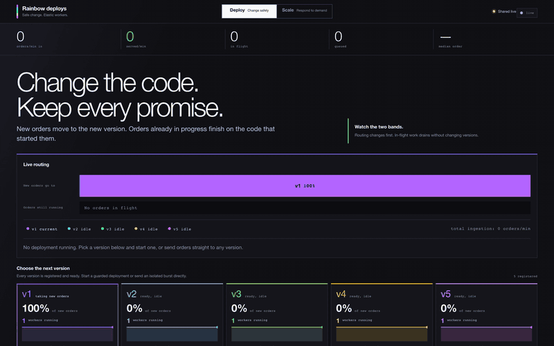

# Rainbow deploys

Demo of **Pinned worker versioning** + **elastic order workers** (local or Lambda).
One Workflow type (`CustomerOrder`), five pipeline shapes (`v1`–`v5`). Orders stay
on the version that took them; rollouts only move *new* traffic.

Code to read: [`internal/orders/workflow_v1.go`](internal/orders/workflow_v1.go) …
[`workflow_v5.go`](internal/orders/workflow_v5.go) (one file = one code bundle /
Lambda image), then [`cmd/worker`](cmd/worker) / [`cmd/lambdaworker`](cmd/lambdaworker).
Design notes: [`DESIGN.md`](DESIGN.md).

[](docs/walkthrough.mp4)

A narrated pass through Deploy, then Scale. The GIF is the inline view; the [MP4](docs/walkthrough.mp4) has the voiceover. Script: [`docs/walkthrough.yaml`](docs/walkthrough.yaml).

## How it works

```mermaid
%%{init: {"theme": "base", "flowchart": {"nodeSpacing": 40, "rankSpacing": 60, "padding": 18}, "themeVariables": {
  "fontSize": "15px",
  "primaryColor": "#141414",
  "primaryTextColor": "#f8fafc",
  "primaryBorderColor": "#444ce7",
  "lineColor": "#1ff1a5",
  "textColor": "#f8fafc",
  "clusterBkg": "#1a1830",
  "clusterBorder": "#465a78",
  "titleColor": "#cacbf9",
  "edgeLabelBackground": "#141414"
}}}%%
flowchart TB
  subgraph card[" "]
    direction TB
    subgraph deploy["DEPLOY"]
      direction TB
      start["Start deployment"]
      gate["Canary orders<br/>pinned to the candidate"]
      ramp["Share of new orders"]
      stay["In-flight orders<br/>stay on their version"]
      start -- "1" --> gate
      gate -- "2 pass" --> ramp
      ramp -- "3" --> stay
    end
    subgraph cloud["TEMPORAL CLOUD"]
      direction TB
      queue["Task on that<br/>version's queue"]
      watch["Monitors the backlog<br/>starts invocations"]
      queue -- "5" --> watch
    end
    subgraph aws["AWS LAMBDA"]
      direction TB
      arn["Qualified ARN<br/>for that version"]
      run["Invocation polls<br/>and runs the tasks"]
      idle["Queue quiet<br/>invocation exits"]
      arn -- "7" --> run
      run -- "8" --> idle
    end
    deploy -- "4" --> cloud
    cloud -- "6 invoke" --> aws
  end

  classDef temporal fill:#141414,stroke:#444ce7,stroke-width:2px,color:#f8fafc
  classDef controller fill:#141414,stroke:#b664ff,stroke-width:2px,color:#f8fafc
  classDef keda fill:#141414,stroke:#1ff1a5,stroke-width:2px,color:#f8fafc
  classDef resource fill:#141414,stroke:#7f86f1,stroke-width:1px,stroke-dasharray:4 3,color:#cacbf9
  classDef pods fill:#141414,stroke:#4fd8ff,stroke-width:2px,color:#f8fafc
  class queue temporal
  class watch controller
  class start,ramp controller
  class gate,stay,run pods
  class arn resource
  class idle keda
  classDef card fill:#141414,stroke:#141414,color:#141414
  class card card
```



1. **Start deployment** on a version that is already registered. v1 through v5 are registered before the demo starts, so a rollout changes routing rather than shipping an image.
2. The gate runs a few real orders **pinned to the candidate**. A bad build fails here, before any of the current share moves.
3. After the gate passes, only the **share of new orders** ramps. Each stage holds, and you can advance it, hold it, set a share by hand, or abort it. An order **stays on the version that started it**.
4. Each of those orders becomes a **task on one version's queue**. A rate or a burst does the same thing. v1 through v5 each have their own queue and their own Lambda, so Cloud only starts invocations for a version that has work waiting.
5. Cloud **monitors that version's backlog**. When the queue needs more capacity, that machinery starts new Lambda invocations.
6. Each invocation is an **InvokeFunction** call on the qualified ARN registered for that version. A larger backlog starts more of them.
7. The invocation connects, **polls that version's queue**, and can run many tasks before it stops. An order pinned to v2 is still executed by v2's Lambda after the ramp has moved on.
8. When the queue is quiet, Cloud **stops calling**. The invocation exits after it finishes the tasks it has, or as it nears its time limit. Nothing replaces it, so that version scales to zero. The dashboard stays up.

`make up` does not run this loop. Locally each version is a process that is already polling. The invoke path is Temporal Cloud.

## Quick start

```bash
make up
open http://localhost:3000
```

| URL | |
| --- | --- |
| Dashboard | http://localhost:3000 |
| Temporal UI | http://localhost:8233 |
| Backend API | http://localhost:8088 |

```bash
make down     # stop + wipe data
make logs
make status
```

## Drive the demo

```bash
make rate N=600
make spike N=5000
make deploy-version V=v3
make break-version V=v4 STEP=Payment
make clear-version V=v4
make rescue V=v4
```

Or use the presenter dashboard:

- **Deploy** (`1`) — start a guarded rollout and watch new routing move while
  in-flight orders remain pinned to their original version.
- **Scale** (`2`) — set a steady rate, add a burst, and watch queued work and
  Lambda workers respond together.
- **Open backstage** — inject a failure and inspect individual order progress.

The hosted dashboard is intentionally shared: every authenticated viewer sees
the same traffic and deployment state.

## Local iteration

```bash
make build
make test
make dev    # host processes; logs in .run-logs/
```

Dashboard against host API: http://localhost:3000/?api=http://localhost:8088

After changing control-plane Workflows: `make reset-control`.

## Config (common)

| Variable | Default | Notes |
| --- | --- | --- |
| `TEMPORAL_ADDRESS` | `localhost:7233` | |
| `TEMPORAL_NAMESPACE` | `default` | |
| `TEMPORAL_API_KEY` | — | presence enables TLS (Cloud) |
| `TEMPORAL_DEPLOYMENT_NAME` | `rainbow-orders` | |
| `ORDER_VERSION` | `v1` | worker: which pipeline |
| `ORDER_PROFILE` | `demo` | `fast` (1s) / `demo` (8s) / `heavy` (40s) |

## Temporal Cloud + Lambda

Search attributes (once per namespace):

```bash
temporal operator search-attribute create --name OrderVersion --type Keyword
temporal operator search-attribute create --name OrderStep    --type Keyword
temporal operator search-attribute create --name OrderHealth  --type Keyword
```

Order workers as serverless (one Lambda per version):

```bash
make lambda-build
EXECUTION_ROLE=arn:aws:iam::<account>:role/<role> \
TEMPORAL_ADDRESS=<ns>.<account>.tmprl.cloud:7233 \
TEMPORAL_NAMESPACE=<ns>.<account> \
TEMPORAL_API_KEY=<key> \
  make lambda-deploy
```

Register each function in Cloud UI (**Workers → Serverless**) with Build ID =
version label (`v1`…`v5`). Backend + control plane stay always-on (not Lambda).

Teardown: `make lambda-teardown`. Do **not** set reserved concurrency per function
(it throttles scale-out). Details in [`DESIGN.md`](DESIGN.md).

## Kubernetes

Edit images / Temporal address in [`deploy/k8s/`](deploy/k8s/), then:

```bash
kubectl -n rainbow create secret generic temporal --from-literal=api-key=<key>
make k8s-apply
```

## Layout

| Path | Role |
| --- | --- |
| `internal/orders` | Pinned order Workflow + activities |
| `cmd/worker` | Process worker (`ORDER_VERSION`) |
| `cmd/lambdaworker` | Same pipeline on Lambda |
| `internal/rollout`, `internal/traffic` | Control plane (unversioned) |
| `cmd/controlworker`, `cmd/backend` | Control worker + API |
| `frontend/` | Static dashboard |
